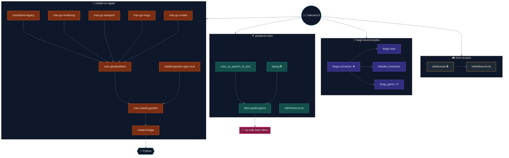
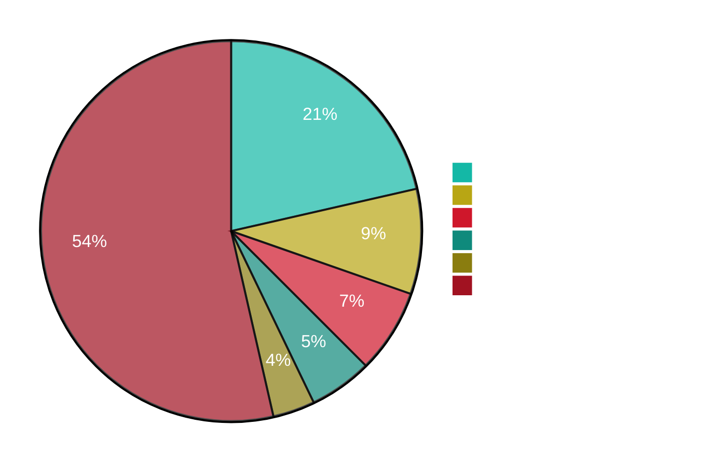
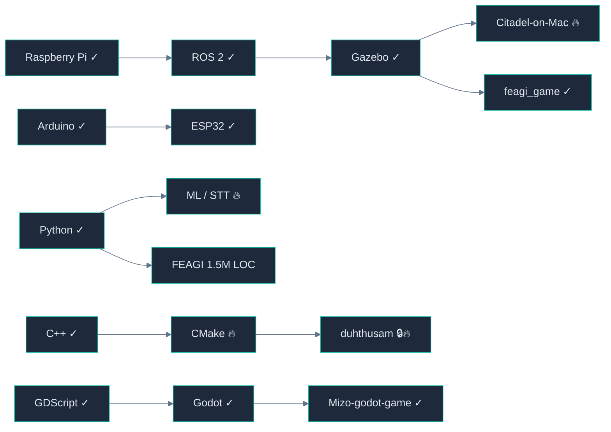

<!--
  README_2 — Live mermaid constellation
-->

# 🌌 kakcalu13's repo constellation

_maker · roboticist · dad — every node is a real repo, every edge a real dependency_

---

---

### 📊 by the numbers

---

### 🛠️ skill graph

