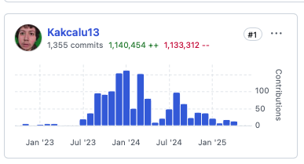

<!-- README_4 — Three pillars (symmetric) -->

# Kakcalu13
### *Roboticist · Open-source maintainer · Mizo language technologist*

I build at the intersection of **robotics simulation**, **neuromorphic computing**, and **language technology** — and I love collaborating. Read every issue. Reply to every email.

---

## Three things I'm building

Three missions, equal weight, each open to collaboration.

---

### 🪶 &nbsp; Pillar I — Mizo language technology

> **Why this matters.** &nbsp; Mizo is the language of my wife and our children — a Tibeto-Burman language of Northeast India. I'm a learner. I can write Mizo, but **I cannot yet ask my computer to listen to it: there is no speech-to-text for Mizo.** No Siri, no Translate parity, almost no public datasets. The phrase *"there isn't one yet"* applies to most of the technology I take for granted in English. So I'm building it.

**Selected work**
- [`mizo_ai_speech_to_text`](https://github.com/Kakcalu13/mizo_ai_speech_to_text) — custom STT pipeline, trained on hand-labelled family recordings
- [`tawng`](https://github.com/Kakcalu13) *(private, in development)* — speak-and-listen mobile app
- [`Mizo-godot-game`](https://github.com/Kakcalu13/Mizo-godot-game) — Godot game teaching Mizo, English, and sign
- [`Inkhelhna-ho-te`](https://github.com/Kakcalu13/Inkhelhna-ho-te) — *"let's play"* — a simple game in Mizo

**How you can help**
&nbsp;&nbsp;&nbsp;**▸** &nbsp; You work on low-resource NLP, speech, or language preservation? **Please reach out.** This is the work I most want collaborators on.

---

### 🍎 &nbsp; Pillar II — Reviving Ignition Citadel on Apple Silicon

> **Why this matters.** &nbsp; Apple Silicon left a generation of robotics simulators behind. Ignition Citadel — used widely in research and education — was effectively stranded on Intel macOS. Twelve repositories later, it runs natively on M-series Macs.

**Selected work**
- [`mac-gazebodistro`](https://github.com/Kakcalu13/mac-gazebodistro) — vcstool bootstrap, cherry-picked forks, OGRE Next Metal, automated build & link fixes
- [`homebrew-legacy`](https://github.com/Kakcalu13/homebrew-legacy) — Ruby tap reviving the legacy program for macOS
- [`mac-citadel-gazebo`](https://github.com/Kakcalu13/mac-citadel-gazebo) — running Gazebo Citadel on M-series
- [`citadel-bridge`](https://github.com/Kakcalu13/citadel-bridge) — pybind11 bridge to Python

Plus the supporting cluster: `mac-gz-rendering` · `mac-gz-transport` · `mac-gz-msgs` · `mac-gz-cmake` · `mac-gz-launch` · `mac-ign-gui3` · `citadel-gazebo-ogre-next`.

**How you can help**
&nbsp;&nbsp;&nbsp;**▸** &nbsp; You're a roboticist on Apple Silicon? Try the bootstrap, file issues, share your config. The cluster is most useful when more eyes are on it.

---

### 🧠 &nbsp; Pillar III — Neuromorphic robotics with FEAGI

> **Why this matters.** &nbsp; FEAGI is an open-source brain-on-silicon project. The connector layer — the canonical PIP package that lets FEAGI drive real and virtual bodies — is largely my work, and it's the bridge between neuromorphic computation and the actual robots, simulators, and creative tools we use every day.

**Selected work**
- [feagi-connector](https://github.com/feagi/feagi-connector) — **1,355 commits · 1.5M+ lines** as core maintainer
- [`feagi-viser`](https://github.com/Kakcalu13/feagi-viser) — FEAGI ↔ Viser visualization integration
- [`blender-connector`](https://github.com/Kakcalu13/blender-connector) — neuromorphic control of Blender models
- [`feagi_game`](https://github.com/Kakcalu13/feagi_game) ⭐3 — mini game using FEAGI · ROS 2 · Gazebo · Godot

**How you can help**
&nbsp;&nbsp;&nbsp;**▸** &nbsp; You want to integrate FEAGI with a new platform, simulator, or robot? I'll help you wire it up.

---

## Technical depth

**Languages (daily):** &nbsp; Python · C++ · GDScript · Bash · Kotlin · Ruby
**Sharpening:** &nbsp; Rust · Zig · Pony · Swift · CMake · React · Android Studio
**Robotics & simulation:** &nbsp; Gazebo · MuJoCo · Webots · Carla · ROS 2 · OGRE Next · pybind11
**Hardware:** &nbsp; Raspberry Pi · Arduino · Micro:bit · ESP32 · industrial servos · IMU · LiDAR · EEG
**DevOps & cloud:** &nbsp; Docker · GitHub Actions · CMake · GCloud · AWS · Azure · Kubernetes · Terraform
**Operating systems:** &nbsp; Linux · macOS (Intel + Apple Silicon) · Windows (XP → 11)

---

📬 &nbsp; **The fastest way to reach me:** open an issue or discussion on any repository at [github.com/Kakcalu13](https://github.com/Kakcalu13).

 

 

*Thank you for stopping by — and if you're working on something for your own language or community, please tell me about it.*

